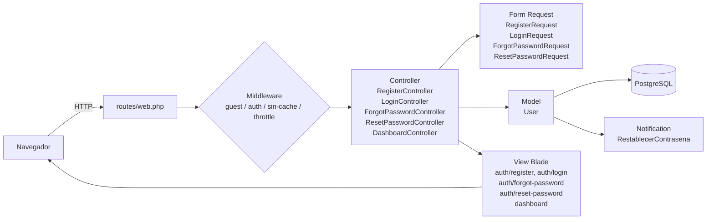
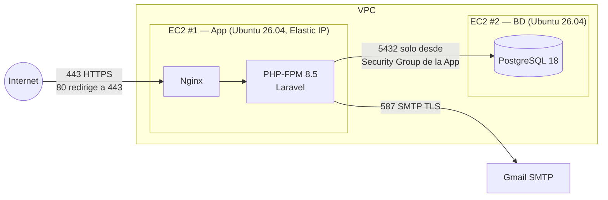

# 1. Arquitectura

## Stack

| Capa | Tecnología |
|---|---|
| Framework | Laravel 12 (PHP 8.2+) — patrón **MVC** |
| Vistas | Blade + CSS propio (`public/css/app.css`), sin build de npm |
| Base de datos | PostgreSQL 17 |
| Autenticación | Guard `web` de Laravel (sesiones en BD, contraseñas con bcrypt) |
| Servidor (AWS) | Ubuntu Server 26.04 LTS + Nginx + PHP 8.5-FPM, PostgreSQL 18, HTTPS con Let's Encrypt |

## MVC en el proyecto

| Elemento | Archivo |
|---|---|
| Rutas | `src/routes/web.php` |
| Modelo | `src/app/Models/User.php` |
| Controladores | `src/app/Http/Controllers/Auth/RegisterController.php`, `LoginController.php`, `ForgotPasswordController.php`, `ResetPasswordController.php`, `DashboardController.php` |
| Validaciones | `src/app/Http/Requests/Auth/RegisterRequest.php`, `LoginRequest.php` (incluye el límite de intentos de HU-05), `ForgotPasswordRequest.php`, `ResetPasswordRequest.php`, `Concerns/ValidaContrasena.php` (reglas de contraseña compartidas) |
| Middleware | `src/app/Http/Middleware/SecurityHeaders.php`, `SinCache.php` (HU-04) |
| Notificaciones | `src/app/Notifications/RestablecerContrasena.php` (correo de HU-03) |
| Vistas | `src/resources/views/layouts/app.blade.php`, `auth/register.blade.php`, `auth/login.blade.php`, `auth/forgot-password.blade.php`, `auth/reset-password.blade.php`, `dashboard.blade.php` |
| Migraciones | `src/database/migrations/` |
| Pruebas | `src/tests/Feature/Auth/RegistroTest.php`, `LoginTest.php`, `RecuperarContrasenaTest.php`, `LogoutTest.php`, `LimiteIntentosTest.php`, `src/tests/Feature/SeguridadTest.php` |

## Rutas

| Método | URL | Acceso | Descripción | HU |
|---|---|---|---|---|
| GET | `/` | público | Página de inicio | — |
| GET | `/salud` | público | "Hola mundo" en JSON para verificar despliegue | infra |
| GET | `/up` | público | Health check nativo de Laravel | infra |
| GET/POST | `/registro` | solo visitantes | Formulario y registro | HU-01 |
| GET/POST | `/login` | solo visitantes | Formulario e inicio de sesión (con límite de intentos fallidos) | HU-02, HU-05 |
| GET/POST | `/recuperar` | solo visitantes | Solicitar enlace de recuperación | HU-03 |
| GET | `/restablecer/{token}?email=` | solo visitantes | Formulario de nueva contraseña (enlace del correo) | HU-03 |
| POST | `/restablecer` | solo visitantes | Guardar la nueva contraseña | HU-03 |
| GET | `/dashboard` | autenticado, sin caché | Área privada | HU-02 |
| POST | `/logout` | autenticado | Cierre de sesión (solo POST con token CSRF) | HU-04 |

## Despliegue en AWS (2 máquinas)

En producción: https://organizador-laravel.duckdns.org

- **Local:** todo en el mismo equipo (`DB_HOST=127.0.0.1`).
- **AWS:** solo cambia el `.env` (`DB_HOST=<IP privada de la EC2 de BD>`). El código es el mismo.
- Ver `infra/aws/README.md` para los pasos.
