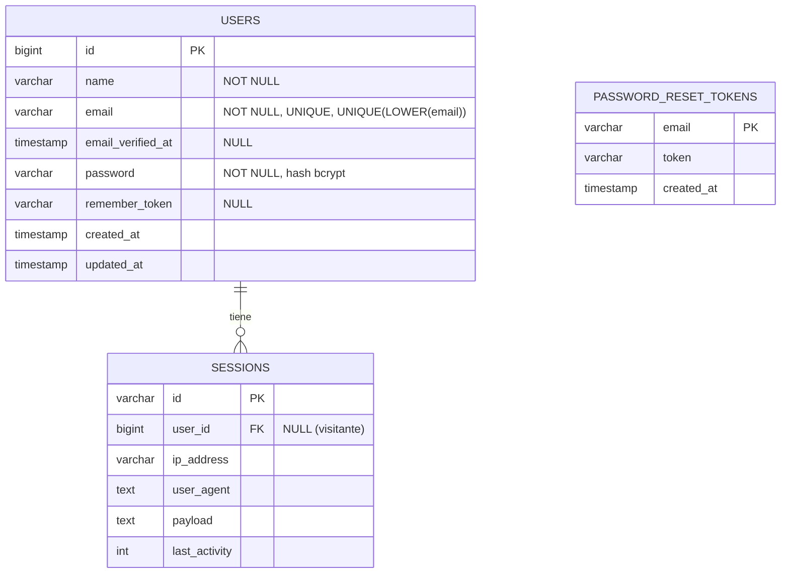

# 2. Diseño de base de datos (Sprints 1 y 2)

Motor: **PostgreSQL 17**. Bases: `organizador` (aplicación) y `organizador_test` (pruebas, requisito del plan TP-S01).

## Modelo entidad-relación

> Las tablas `cache`, `jobs` y `migrations` son de infraestructura de Laravel.
> Sprint 2 no requiere migraciones nuevas: usa tablas que ya existían.

## Tablas usadas en Sprint 2

| Tabla | HU | Uso |
|---|---|---|
| `password_reset_tokens` | HU-03 | Un registro por correo con el **hash** (bcrypt) del token de recuperación y su `created_at`. El token en claro solo viaja en el correo. Se valida que tenga menos de 30 minutos (`config/auth.php` → `expire = 30`) y se borra al usarse (un solo uso) o al pedir uno nuevo. |
| `sessions` | HU-04 | Al cerrar sesión se borra el registro de la sesión (`session()->invalidate()`). Al restablecer la contraseña se borran todas las sesiones de ese usuario. |
| `cache` | HU-05 | Contadores del límite de intentos: `login-fallos:<hash>` (fallos en la ventana de 15 min) y `login-bloqueo:<hash>` (bloqueo de 15 min). `<hash>` = SHA-256 de `correo|IP`, así no se guardan correos en la caché. |

## Diccionario de datos — `users`

| Campo | Tipo | Restricción | Criterio |
|---|---|---|---|
| id | bigserial | PK | — |
| name | varchar(255) | NOT NULL | CA-01.1, CA-01.2 |
| email | varchar(255) | NOT NULL, UNIQUE, índice único `LOWER(email)`; se guarda en minúsculas | CA-01.3 |
| password | varchar(255) | NOT NULL, hash bcrypt (`$2y$12$...`) | CA-01.7 |
| email_verified_at | timestamp | NULL | (futuro) |
| remember_token | varchar(100) | NULL | — |
| created_at / updated_at | timestamp | — | — |

## Migraciones

| Archivo | Contenido |
|---|---|
| `0001_01_01_000000_create_users_table.php` | `users`, `password_reset_tokens`, `sessions` |
| `0001_01_01_000001_create_cache_table.php` | caché (y en HU-05 el contador de intentos) |
| `0001_01_01_000002_create_jobs_table.php` | colas (envío de correos en HU-03) |
| `2026_10_20_000001_add_lower_email_unique_index_to_users_table.php` | `CREATE UNIQUE INDEX users_email_lower_unique ON users (LOWER(email))` |
