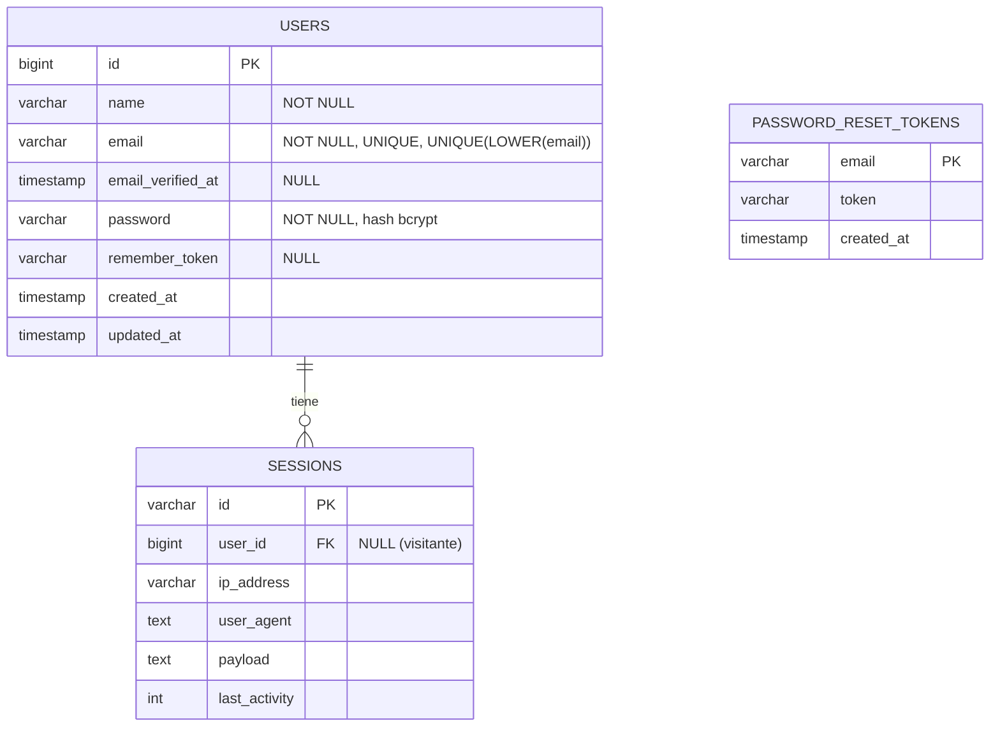

# 2. Diseño de base de datos (Sprint 1)

Motor: **PostgreSQL 17**. Bases: `organizador` (aplicación) y `organizador_test` (pruebas, requisito del plan TP-S01).

## Modelo entidad-relación

> `password_reset_tokens` ya existe por defecto en Laravel; se usará en **HU-03** (recuperar contraseña).
> Las tablas `cache`, `jobs` y `migrations` son de infraestructura de Laravel.

## Diccionario de datos — `users`

| Campo | Tipo | Restricción | Criterio |
|---|---|---|---|
| id | bigserial | PK | — |
| name | varchar(255) | NOT NULL | CA-01.1, CA-01.2 |
| email | varchar(255) | NOT NULL, UNIQUE, índice único `LOWER(email)`; se guarda en minúsculas | CA-01.3 |
| password | varchar(255) | NOT NULL, hash bcrypt (`$2y$12$...`) | CA-01.7 |
| email_verified_at | timestamp | NULL | (futuro) |
| remember_token | varchar(100) | NULL | — |
| created_at / updated_at | timestamp | — | — |

## Migraciones

| Archivo | Contenido |
|---|---|
| `0001_01_01_000000_create_users_table.php` | `users`, `password_reset_tokens`, `sessions` |
| `0001_01_01_000001_create_cache_table.php` | caché (y en HU-05 el contador de intentos) |
| `0001_01_01_000002_create_jobs_table.php` | colas (envío de correos en HU-03) |
| `2026_10_20_000001_add_lower_email_unique_index_to_users_table.php` | `CREATE UNIQUE INDEX users_email_lower_unique ON users (LOWER(email))` |
