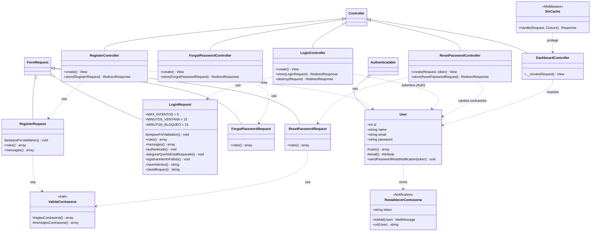
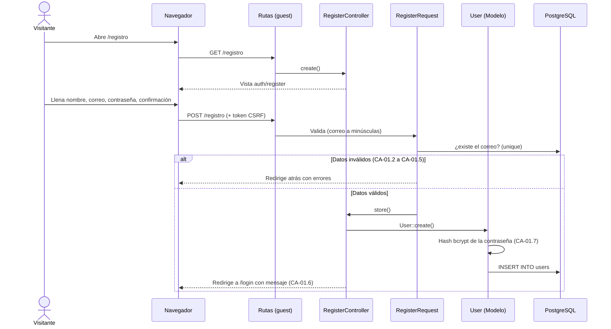
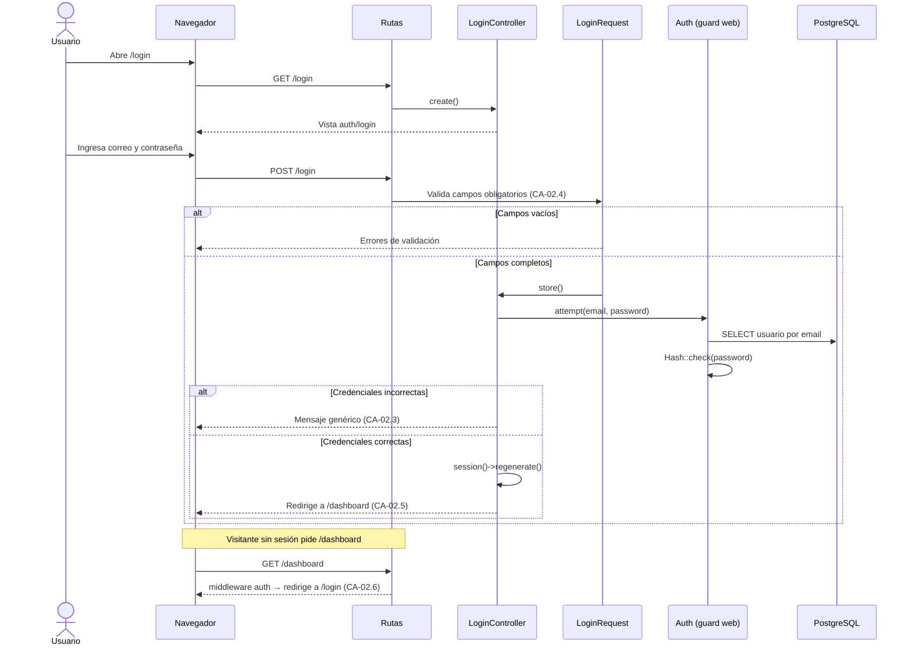
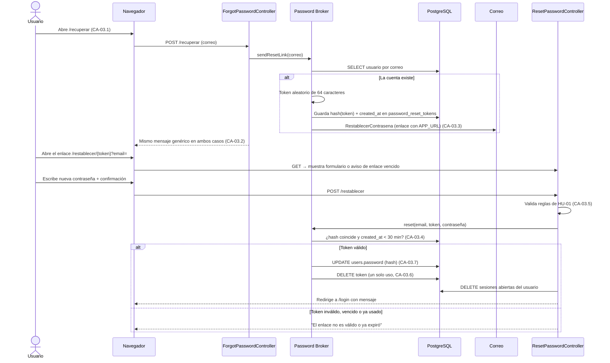
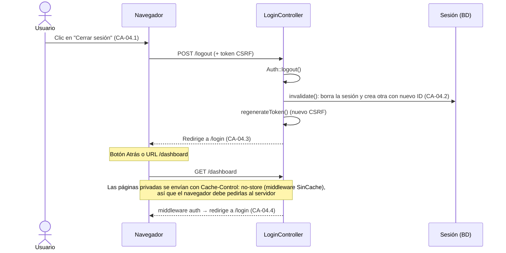
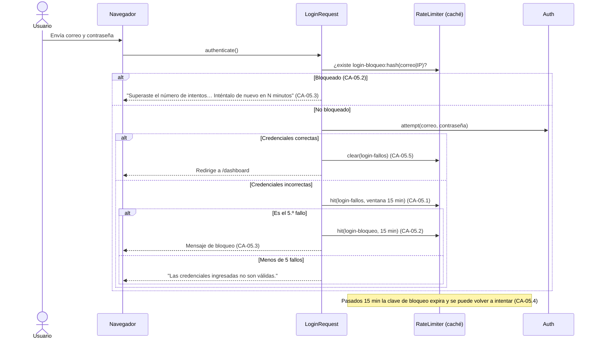

# 3. Diseño funcional (clases y secuencias)

## Diagrama de clases

## Secuencia HU-01 — Registro

## Secuencia HU-02 — Inicio de sesión

## Secuencia HU-03 — Recuperación de contraseña

## Secuencia HU-04 — Cierre de sesión

## Secuencia HU-05 — Límite de intentos fallidos

